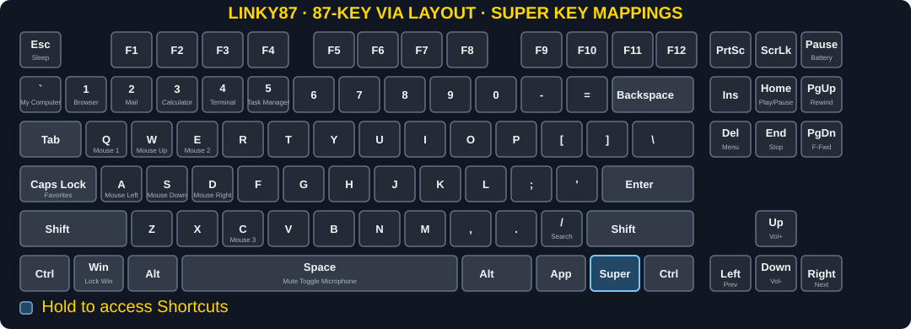

# My Linky87 VIA secondary layer and Super shortcuts

The base layer is unchanged from the expected keys. The image below shows the additional macros that are available by holding down the Super key and pressing one of the values below.

